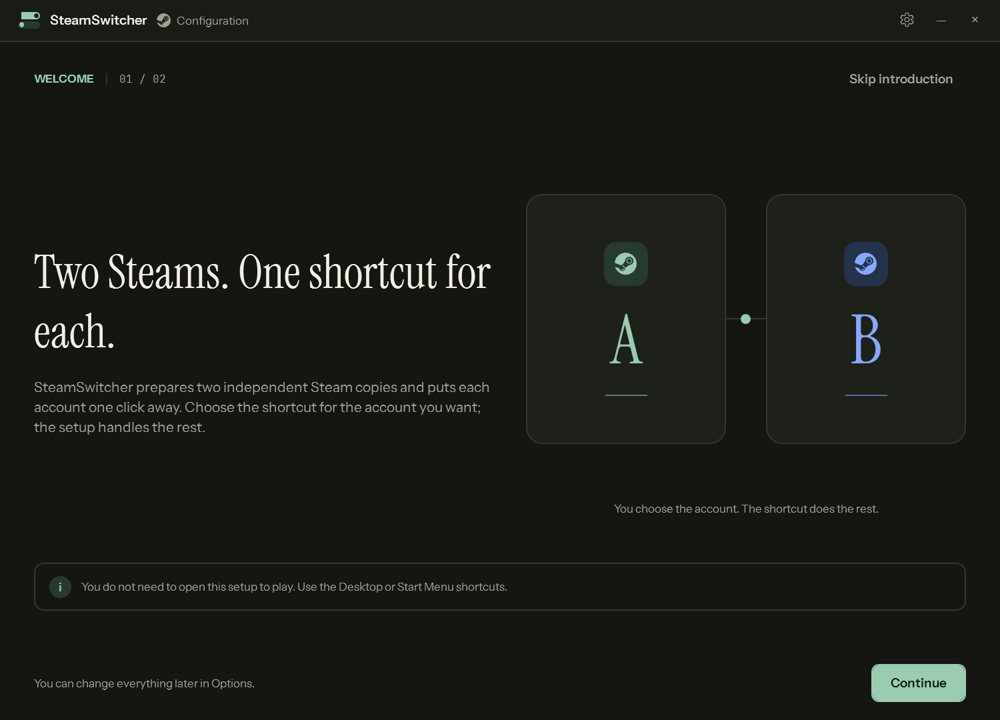
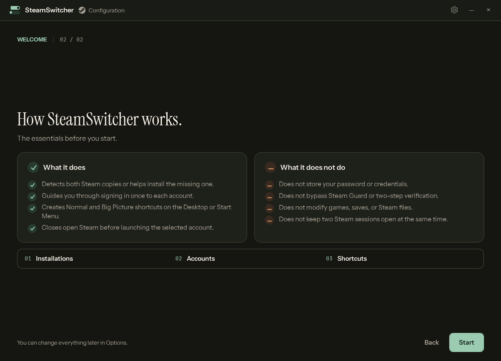

# SteamSwitcher

SteamSwitcher is a Windows setup utility that prepares **two independent
Steam installations** and puts each account one click away. It is designed to
keep accounts separate without mixing sessions or editing Steam files by hand.

The current version is **1.3.2**.

## What it does

- Detects two Steam installations or helps install the missing one.
- Guides the user through signing in once per account and checks whether
  Steam has **Remember password** enabled.
- Creates Normal and Big Picture shortcuts on the Desktop, in the Start Menu,
  or in a dedicated SteamSwitcher folder.
- Restores and focuses an already running copy, including when it is minimized
  or minimized to the Windows notification area.
- Lets the user open the copy that belongs to each account from the setup
  window itself.

## What it does not do

- It does not store passwords or credentials.
- It does not send account credentials anywhere.
- It does not bypass Steam Guard or two-step verification.
- It does not keep two Steam sessions open at the same time.
- It does not modify games, saves, or internal Steam files.
- It does not need to stay running in the background.

## Screenshots

### Welcome



### How it works



## Download

The **Releases** page publishes two archives:

| File | Contents |
|---|---|
| `SteamSwitcher-1.3.2-portable.zip` | Self-contained win-x64 setup application and backend. No .NET 9 installation required. |
| `SteamSwitcher-1.3.2-source.zip` | Complete source code, with no compiled binaries. |

Extract the portable archive completely before running
`SteamSwitcher.Setup.exe`. Do not run it from inside the ZIP.

## Quick start

1. Extract `SteamSwitcher-1.3.2-portable.zip` to a stable folder.
2. Run `SteamSwitcher.Setup.exe`.
3. Follow the welcome screen and the four-step flow:
   Installations → Accounts → Shortcuts → Summary.
4. Select **Apply and create shortcuts**.
5. Use the shortcuts on the Desktop or in the Start Menu.

The application uses the Windows display language by default. A language
selector is available in the setup options.

## Requirements

### Portable

- 64-bit Windows 10 or Windows 11.
- Internet access if a new Steam copy must be downloaded.
- Windows UAC approval when installing Steam.

The portable build includes the required runtime. .NET 9 does not need to be
installed.

### Source

- .NET 9 SDK for the WPF setup application.
- .NET Framework 4 for the backend (included with Windows).
- PowerShell 5.1 or later.

## Build from source

```powershell
# Setup application
.\build.ps1

# Backend
cd backend
.\build.ps1
```

The development build of the setup application is written to:

```text
src\SteamSwitcher.Setup\bin\Debug\net9.0-windows\SteamSwitcher.Setup.exe
```

To publish a self-contained portable build:

```powershell
dotnet publish src\SteamSwitcher.Setup\SteamSwitcher.Setup.csproj `
  -c Release `
  -r win-x64 `
  --self-contained true `
  -p:PublishSingleFile=false `
  -p:DebugType=None `
  -p:DebugSymbols=false `
  -o output
```

Then copy `backend\SteamSwitcher.exe` to `output\SteamSwitcher.exe`.

## Repository layout

```text
src/SteamSwitcher.Setup   WPF setup application
backend/SteamSwitcher.cs  Steam launch and account-switching backend
backend/build.ps1         Backend build script
build.ps1                 Setup application build script
licenses/                 Third-party license texts
docs/                     Presentation screenshots
```

## Security and privacy

SteamSwitcher works locally. It includes no telemetry, does not send
credentials, and does not automate the sign-in process inside Steam. The
**Remember password** check reads Steam's local account file.

This build is not Authenticode-signed. Windows SmartScreen or some antivirus
products may show a reputation warning. The source code is published so it can
be audited. Fully removing this warning requires signing both executables with
a code-signing certificate.

## License and trademarks

This project is distributed under the **MIT License**. See `LICENSE.txt` and
`THIRD-PARTY-NOTICES.txt`.

Steam and Valve are trademarks of Valve Corporation. SteamSwitcher is not
affiliated with or endorsed by Valve.
